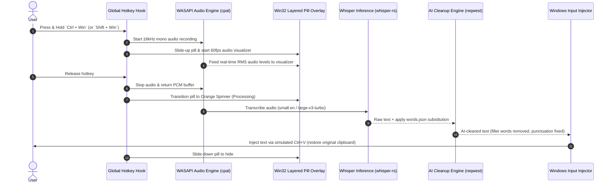

# Wispr Rust — Technical Specification & Implementation Plan

---

## 1. Executive Summary & End Goal

**Wispr Rust** is an ultra-lightweight, system-wide voice-to-text dictation tool for Windows. It provides push-to-talk speech recognition with instantaneous AI punctuation/filler-word cleanup and direct text injection into any active window.

### The Objective
Re-implement the complete feature set of `wispr_py` in native Rust to solve runtime bloat:
* **Active RAM Target:** **< 150 MB** (vs. ~885 MB in Python).
* **Cold Start Time:** **< 100 ms** (instant tray launch).
* **Host Application Footprint:** **< 15 MB** (native Win32 API, zero garbage collection).
* **Delivery:** Single standalone executable (`Wispr.exe`) with embedded assets and optional local GGUF Whisper weights.

---

## 2. User Experience & Interaction Flow



### Hotkey Triggers
1. **`Ctrl + Win` (Hold / Release):** English Dictation (`small.en`).
2. **`Shift + Win` (Hold / Release):** Romanian / Multilingual Dictation (`large-v3-turbo`).
3. **Media Playback Management:**
   * When recording begins: automatically pause active media (simulating `VK_MEDIA_PLAY_PAUSE`).
   * When recording ends: resume media playback if it was previously playing.

---

## 3. Overlay Design & Visual Specification

The floating overlay is an always-on-top, borderless, click-through pill positioned above the Windows taskbar.

### Window Geometry & Position
* **Dimensions:** `120px` width × `34px` height (Pill radius: `17px`).
* **Placement:** Horizontally centered on primary monitor, `24px` above the taskbar.
* **Window Flags:** `WS_EX_LAYERED | WS_EX_TOPMOST | WS_EX_TOOLWINDOW | WS_EX_TRANSPARENT | WS_EX_NOACTIVATE`.

### Visual States & Animations

#### 1. Entrance / Exit Animation
* **Slide Up:** Translates from `screen_height` up to `screen_height - 34 - 24` using ease-out cubic interpolation (~150ms).
* **Slide Down:** Translates downwards out of view when processing finishes (~120ms).

#### 2. Recording State (Audio Visualizer)
* **Pill Background:** Dark translucent fill `rgba(0, 0, 0, 0.90)`.
* **Visualizer:** **16 vertical capsules/dots** colored Indigo (`#818cf8`).
* **Dynamics:**
  * Dot radius: `2px` width, `1.5px` gap between capsules.
  * Dot height scales dynamically with microphone input RMS volume (clamped `2px` min to `14px` max).
  * A cosine bell envelope (`0.25 + 0.75 * cos(pos)^2`) weights the center bars higher than outer bars for a natural waveform aesthetic.

#### 3. Processing State (Spinning Orbiter)
* **Transition:** Smooth cross-fade from waveform bars into spinner.
* **Spinner:** **8 orbital dots** orbiting a circle with radius `9px` centered in the pill.
* **Color & Opacity:** Orange palette (`#fb923c` trailing into `#201008`) with 60 FPS rotational motion.

---

## 4. Architecture & Technology Stack

| Domain | Rust Technology / Crate | Rationale |
| :--- | :--- | :--- |
| **Audio Capture** | `cpal` (WASAPI backend) | Zero-latency 16 kHz mono capture directly into a pre-allocated ring buffer. |
| **Global Hotkeys** | `windows-rs` (`SetWindowsHookExW` with `WH_KEYBOARD_LL`) | Reliable non-blocking detection of `Ctrl+Win` and `Shift+Win` combinations. |
| **Overlay Graphics** | `tiny-skia` / `softbuffer` or Direct2D (`windows::Win32::Graphics`) | High-DPI supersampled rendering (4× Lanczos or bilinear) with `UpdateLayeredWindow`. Memory footprint < 3 MB. |
| **Whisper STT** | `whisper-rs` (bindings to `whisper.cpp`) | C++ static linking, `mmap` model loading, Q4/Q5/Q8 GGUF support, optional cuBLAS/Vulkan. |
| **LLM Post-Processing**| `reqwest` (tokio async) + `serde_json` | Non-blocking streaming/JSON calls to Gemini, OpenRouter, LM Studio, Ollama. |
| **Text Injection** | `arboard` (Clipboard) + `windows-rs` (`SendInput`) | Backup user clipboard $\to$ paste cleaned text via `Ctrl+V` $\to$ restore user clipboard. |
| **System Tray** | `tray-icon` or Win32 `Shell_NotifyIconW` | Native tray icon with menu (Provider selection, Clean mode toggle, Words reload, Exit). |

---

## 5. Text Cleanup & Prompt Specification

### Custom Dictionary Replacement (`words.json`)
Before sending text to LLMs, raw transcription passes through word replacements:
* Case-insensitive regex matching for common homophones, developer jargon, acronyms, or specific proper nouns (e.g. `Wispr`, `PostgreSQL`, `TypeScript`).

### LLM System Prompt
```text
You are a voice transcription cleanup assistant. The user will give you raw speech-to-text output.
Your job: remove filler words (um, uh, like, you know, etc.) and fix punctuation/capitalization.
CRITICAL: preserve the user's exact words, phrasing, and meaning.
Do NOT rephrase, reword, restructure, or 'improve' the text.
Only remove filler words and add punctuation — change nothing else.
Return ONLY the cleaned text. No explanations, no quotes, no preamble.
```

### Provider Support & Fallback Matrix
1. **Local LM Studio:** `http://localhost:1234/v1` (Default model: `qwen2.5-1.5b-instruct` or `qwen2.5-3b-instruct`).
2. **Local Ollama:** `http://localhost:11434/v1` (`qwen2.5:1.5b`).
3. **OpenRouter:** `https://openrouter.ai/api/v1` (`openrouter/free` or user-specified model).
4. **Google Gemini:** `gemini-2.0-flash` REST API.
5. **Fallback:** If LLM request times out (>2000ms) or errors, gracefully paste the raw transcription with dictionary substitutions.

---

## 6. Step-by-Step Implementation Roadmap

```
Phase 1: Project Skeleton & Audio Engine
  ├── Initialize Cargo workspace in Wispr_rust/
  ├── Configure cpal WASAPI input stream (16kHz, mono, f32/i16)
  └── Implement RMS audio-level meter for real-time visualizer feed

Phase 2: Windows System Hooks & Input Injection
  ├── Implement low-level keyboard hook (Ctrl+Win, Shift+Win detection)
  ├── Implement media play/pause toggle simulation
  └── Build clipboard backup/restore + SendInput Ctrl+V injection

Phase 3: Win32 Layered Overlay (UI & Animations)
  ├── Create layered borderless Win32 window (WS_EX_LAYERED)
  ├── Implement software renderer using tiny-skia (Pill background + 16 animated audio capsules)
  ├── Implement 8-dot rotating processing spinner
  └── Wire smooth slide-up / slide-down window animations

Phase 4: Whisper Inference Engine
  ├── Integrate whisper-rs with whisper.cpp static build
  ├── Implement model manager for small.en (English) and large-v3-turbo (Romanian)
  └── Add words.json custom vocabulary substitution parser

Phase 5: LLM Client & Cleanup Pipeline
  ├── Build async HTTP client with reqwest for Gemini, OpenRouter, LM Studio, Ollama
  ├── Implement prompt formatter and timeout/error fallback logic
  └── Connect STT output -> dictionary -> LLM -> clipboard paste pipeline

Phase 6: System Tray & Configuration
  ├── Implement native Windows tray icon and context menu
  ├── Add .env / config.toml parser for API keys and provider selection
  └── Add live provider switching and log viewer

Phase 7: Optimization & Memory Profiling
  ├── Verify total memory consumption is <150 MB under active transcription
  ├── Profile CPU utilization during 60 FPS overlay animation
  └── Build optimized release binary with LTO and stripped symbols
```
